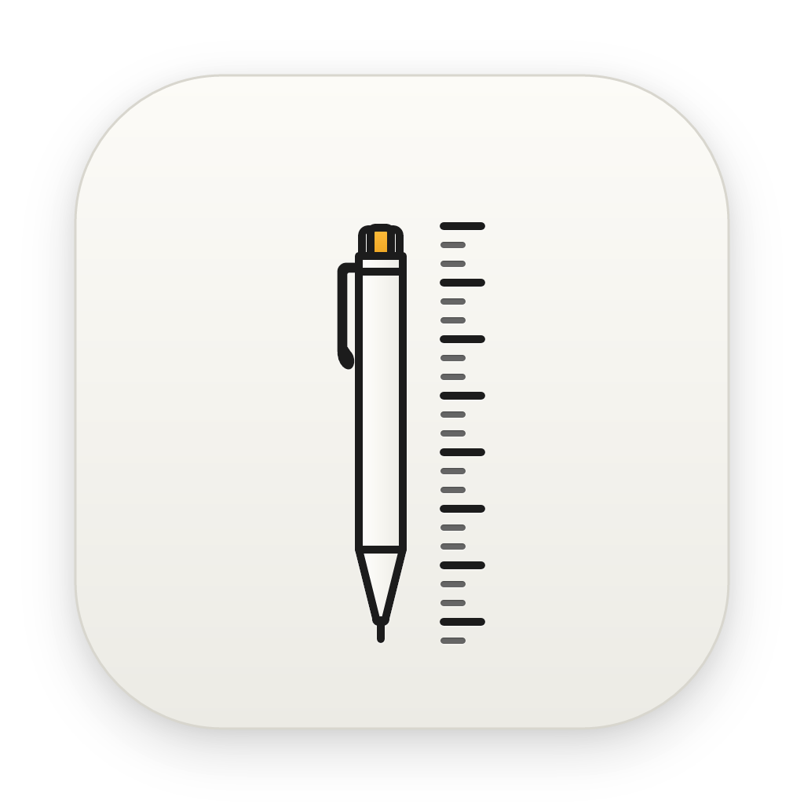

# Scratch

<div align="center">
  
  
  <h3>A minimalist, offline-first markdown instrument inspired by classic Braun industrial design.</h3>

  <p>
    <a href="https://img.shields.io/badge/platform-macOS-lightgrey"></a>
    <a href="https://img.shields.io/badge/platform-Windows-blue"></a>
    <a href="https://img.shields.io/badge/platform-Linux-orange"></a>
    <a href="https://github.com/erictli/scratch/blob/main/LICENSE"></a>
  </p>

  <p>
    <a href="https://www.ericli.io/scratch">Website</a> · 
    <a href="https://github.com/erictli/scratch/releases">Releases</a> · 
    <a href="./AGENTS.md">Agent Architecture</a> · 
    <a href="./CLAUDE.md">Developer Guide</a>
  </p>
</div>

---

## Overview

Scratch is a cross-platform desktop note-taking instrument built with **Tauri v2**, **React 19**, and **TipTap**. Drawing inspiration from Dieter Rams' design ethos, Scratch combines the tactile feel of precision hardware instruments with a modern, distraction-free markdown editing engine.

Your notes live as plain `.md` files directly on your filesystem. No account required, no proprietary databases, and no cloud lock-in.

---

## Key Features

* **Offline-First & Local Storage**: Notes are plain `.md` files in a folder you choose. You retain complete ownership and portability of your data.
* **Braun Industrial Instrument Aesthetic**: Tactile buttons, matte surfaces, signal yellow/orange accents, and typography crafted for legibility and visual calm.
* **Fluid Dual-Mode Editing**:
  * Rich-text WYSIWYG editing with live markdown formatting.
  * Instant raw Markdown source view (`Cmd+Shift+M`) for direct editing of raw markdown and frontmatter.
* **Intelligent Tag Taxonomy**:
  * Color-coded tag pills with a 24-shade curated Braun palette.
  * Drag-to-reorder, rename, custom color picker, and instant library filtering.
  * Seamlessly stored as YAML frontmatter (`tags: [...]`) while staying hidden from the visual editor and PDF export for a clean reading experience.
* **Responsive Floating Format Bar**:
  * Sits comfortably at the bottom center of the editor.
  * Compact **Heading** (`H1`/`H2`/`H3`) and **List** dropdown menus.
  * Intelligently collapses secondary tools into an overflow **More (`...`)** menu when the window or editor size is narrow.
* **Technical Markdown Tools**:
  * **Code Blocks**: Syntax highlighting for 20+ languages with copy and language switcher.
  * **Math Equations**: KaTeX-powered block math (`$$...$$`).
  * **Mermaid Diagrams**: Interactive flowcharts, sequence diagrams, and architecture charts rendered inside code blocks.
  * **Wikilinks**: Type `[[` to link notes with autocomplete.
  * **Slash Commands**: Type `/` to insert formatting blocks instantly.
* **Full-Text Tantivy Search**: Instant fuzzy and prefix search across titles and note bodies via the Command Palette (`Cmd+P`) and Library Search (`Cmd+Shift+F`).
* **Focus & Zen Mode (`Cmd+Shift+Enter`)**: Distraction-free writing with animated sidebar and header fades.
* **Pair with Local AI CLIs**: Edit notes using your preferred local CLI tool (Claude Code, OpenAI Codex, OpenCode, or fully offline with Ollama).
* **Multi-Device Sync Options**:
  * **iCloud Drive (macOS)**: Native folder sync that automatically detects and materializes placeholder files.
  * **Git Sync**: Built-in repository status, automated commits, and remote push/pull.
* **Export Suite**:
  * Clean, print-ready PDF export (`Cmd+Shift+P`).
  * Download `.md` markdown files.
  * Copy note as formatted HTML or plain text.

---

## Installation

### macOS

**Homebrew (Recommended)**:
```bash
brew tap erictli/tap
brew install --cask erictli/tap/scratch
```

**Manual Download**:
1. Download the latest `.dmg` from [Releases](https://github.com/erictli/scratch/releases).
2. Open the DMG and drag Scratch to Applications.

### Windows

Download the latest `.exe` installer from [Releases](https://github.com/erictli/scratch/releases) and launch the setup. (Requires WebView2, pre-installed on Windows 11).

### Linux

Download the latest `.AppImage` or `.deb` package from [Releases](https://github.com/erictli/scratch/releases).

---

## Keyboard Shortcuts

Scratch is designed to be fully operated via keyboard:

| Shortcut | Action |
| :--- | :--- |
| `Cmd+P` | **Command Palette / Search or jump...** |
| `Cmd+N` | New note |
| `Cmd+D` | Duplicate note |
| `Cmd+Backspace` / `Delete` | Delete note |
| `Cmd+K` | **Add / edit hyperlink** |
| `Cmd+F` | Find in note |
| `Cmd+Shift+F` | Search note library (Tantivy) |
| `Cmd+Shift+M` | Toggle Markdown raw source mode |
| `Cmd+Shift+Enter` | Toggle Focus mode |
| `Cmd+Shift+C` | Copy & Export menu |
| `Cmd+Shift+P` | Print / Export as PDF |
| `Cmd+R` | Refresh current note from disk |
| `Cmd+\` | Toggle library sidebar |
| `Cmd+,` | Open settings |
| `Cmd+B` / `Cmd+I` | Bold / Italic |
| `Cmd+=` / `Cmd+-` / `Cmd+0` | Zoom in / Zoom out / Reset |
| `↑` / `↓` | Navigate note list |

> **Note**: On Windows and Linux, substitute `Ctrl` for `Cmd`.

---

## Development & Building

**Prerequisites**: Node.js 18+, Rust 1.77+

```bash
# Clone the repository
git clone https://github.com/erictli/scratch.git
cd scratch

# Install frontend dependencies
npm install

# Run full desktop app in development
npm run tauri dev

# Typecheck and build frontend
npm run build

# Build release desktop app binary
npm run tauri build
```

For agent instructions and subsystem architectural details, refer to [AGENTS.md](./AGENTS.md) and [CLAUDE.md](./CLAUDE.md).

---

## License

Scratch is open source software released under the [MIT License](LICENSE).
